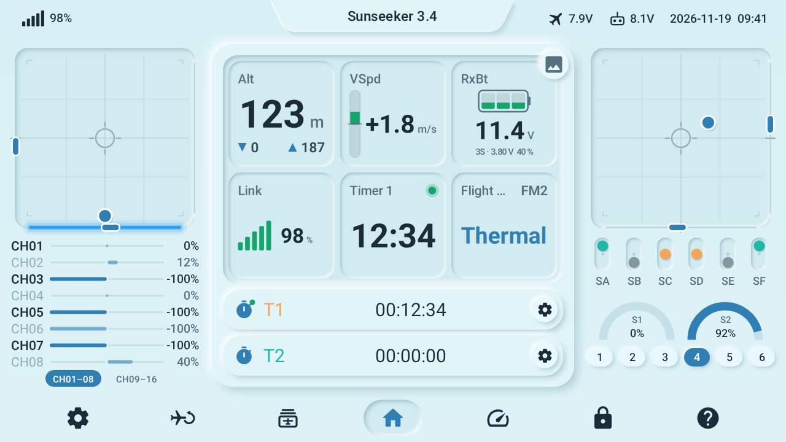
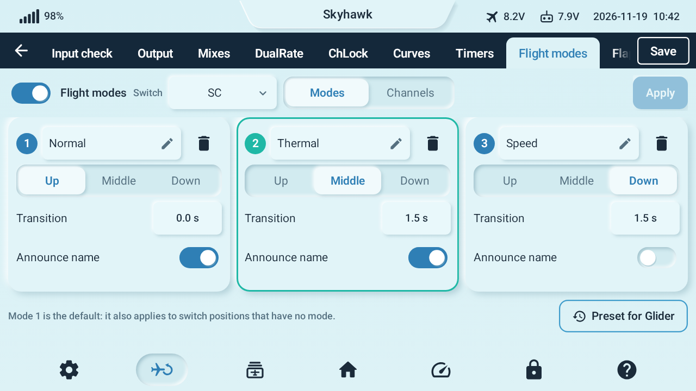

# open-ax12

An open-source replacement for the stock app on the **RadioMaster AX12** transmitter. It keeps the
look and feel of the stock app and adds EdgeTX-style features on top: logical switches, special
functions, voice alerts with telemetry variables, a variometer, flight modes, flaps/wing mixing,
custom model pictures and a configurable telemetry dashboard.

> **Status: v0.2.1, early alpha.** It runs on the AX12 and shows live sticks, switches and channels
> correctly. Most configuration screens have so far only been exercised against the built-in
> simulator. Check every model on the ground (receiver connected, propeller off) before you fly
> with it. Firmware updates stay in the stock app.

## Install on the AX12

[](https://github.com/sp33dlink/open-ax12/releases/latest/download/open-ax12.apk)

1. On the radio, open this page in the web browser and tap **Download APK** above (or get
   `open-ax12.apk` from the [latest release](https://github.com/sp33dlink/open-ax12/releases/latest)).
2. Open the download. When Android asks, allow the browser to install apps
   ("Install unknown apps"), then tap **Install**.
3. Start open-ax12. It closes the stock RadioMaster app by itself before it connects — only one app
   can use the radio at a time — and can start automatically when the radio boots (both on by
   default, shown on first start and under System → App).

Connecting takes about 15–20 s after the app starts; the radio itself needs about 12 s before it
answers. To go back to the stock app, close open-ax12 (notification → Quit) and open the stock app.
Firmware updates stay in the stock app.

| Home with pinned telemetry widgets | Flight modes, compiled into the radio's mixer |
|---|---|
|  |  |

<sub>Screenshots rendered from simulated data.</sub>

## Features

- **Home:** stick pads that highlight a border at full deflection and the centre at dead centre;
  channel list CH1–CH16; timers; switches and knobs; tap the model picture to flip to pinned
  telemetry widgets.
- **Model setup:** input check, outputs, mixes (with live bars and an "explain" line), dual
  rates, channel lock, curves with a graphical editor, timers.
- **Functions:** flight modes, flaps / wing (glider, plane, flying wing; multirotor and helicopter
  presets), logical switches L1–L32, special functions SF1–SF64, voice alerts, vario tones.
  Everything that changes channel outputs is compiled into the radio's own mixes, curves and dual
  rates, so it keeps working if the app is closed.
- **Models:** model library on internal storage (`OpenAX12/models/`), templates, custom pictures,
  snapshots, export / import as `.oax12` through the Android share sheet.
- **Telemetry:** widget pages, sensor list (SDK and CRSF), alarms, last GPS position, CSV flight
  logs.
- **System:** radio and audio settings, ELRS menu, calibration, pre-flight check, backup,
  diagnostics, and a simulator for development without a radio.

All settings are per model except the system settings.

## Building

Requirements: JDK 21, Android SDK with platform `android-37.0`, NDK `29.0.14206865` and CMake
`3.22.1` (Gradle installs missing NDK/CMake packages when the SDK licences are accepted).

```bash
./gradlew assembleDebug
```

The APK ends up in `app/build/outputs/apk/debug/app-debug.apk`. It only contains arm64-v8a code.

Full check (build + all unit tests):

```bash
./gradlew assembleDebug testDebugUnitTest :core:model:test :core:engine:test
```

### Development builds

Every push to `develop` and `master` produces a dev APK (artifact `open-ax12-dev-apk` of the
[Android workflow](../../actions/workflows/android.yml)). Install one, or your own build, with USB
debugging enabled on the radio:

```bash
adb install -r app/build/outputs/apk/debug/app-debug.apk
```

Dev APKs and release APKs are signed with different keys: uninstall open-ax12 once when switching
between them.

### The RadioMaster SDK

The app talks to the radio through RadioMaster's prebuilt C++ SDK (`rmAxSdk1`, Qt 6 inside).
Its files are **not** part of this repository. `scripts/fetch-sdk.sh` downloads them from a pinned
upstream commit and verifies their SHA-256 checksums; Gradle runs it automatically when a file is
missing. `scripts/fetch-sdk.sh --docs` also fetches the SDK manuals and the vendor demo into
`docs/sdk/` for reference.

### Versioning

`versionCode` is the number of commits on `HEAD`, so every build from `develop` / `master` installs
over the previous one. Dev builds are named `<version>-dev.<commits>+<sha>`; release builds
(`-Popenax12.release=true`) are named `<version>`. The version is `baseVersionName` in
`app/build.gradle.kts`.

### Releases

Bump `baseVersionName` (and update `docs/RELEASE_NOTES.md`) through a pull request into `develop`,
then merge `develop` into `master`. When `master` has a version without a tag `v<version>`, the
Android workflow builds and signs the release APK, creates the tag and the GitHub release with
`open-ax12.apk` attached. Do not create the tag or the release by hand: releases are
immutable, so a release created first cannot get the APK any more.

Releases need a stable signing key. It lives as four secrets in the GitHub environment `release`
(Settings → Environments → release), which only the `master` branch may use, and only the release
job uses that environment: pull requests and `develop` never see the key. Create the key once and
keep the `.jks` file and its password safe, outside the repository (for example in a password
manager) — GitHub secrets cannot be read back, and without the key no update can be installed over
an existing install:

```bash
keytool -genkeypair -v -keystore openax12-release.jks -storetype PKCS12 -alias openax12 -keyalg RSA -keysize 4096 -validity 36500
```

```bash
base64 -i openax12-release.jks | gh secret set OPENAX12_KEYSTORE_BASE64 --env release
```

```bash
gh secret set OPENAX12_KEYSTORE_PASSWORD --env release
```

```bash
gh secret set OPENAX12_KEY_ALIAS --env release --body openax12
```

```bash
gh secret set OPENAX12_KEY_PASSWORD --env release
```

Dev APKs from CI are signed with a throw-away debug key, so a release cannot be installed over a
dev APK (or the other way round) without uninstalling first.

### Without a radio

On anything that is not an AX12 (an emulator, a phone) the app uses a built-in simulator with a
mixer simulation. Use an arm64 emulator; the simulator panel is under System.

## Project layout

| Module | Contents |
|---|---|
| `:core:model` | Domain types and the per-model `extras.json` schema (pure Kotlin) |
| `:core:radio` | `Radio` interface and the `FakeRadio` simulator |
| `:sdk` | JNI bridge to the RadioMaster SDK (`SdkRadio`) |
| `:core:engine` | Logical switches, special functions, templates, flight-mode / wing compilers (pure Kotlin) |
| `:core:audio` | Text-to-speech, tones, vario, haptics |
| `:core:data` | Model library, settings, telemetry, CRSF decoding, import / export, logging |
| `:core:runtime` | Runtime engine, configuration session, app graph |
| `:core:designsystem`, `:core:widgets`, `:core:navigation` | UI building blocks |
| `:feature:*` | Screens: home, model setup, models, telemetry, functions, system |
| `:app` | Application, navigation shell, foreground service |

Further documentation:

- [docs/SPEC.md](docs/SPEC.md): feature specification
- [docs/ASSUMPTIONS.md](docs/ASSUMPTIONS.md): device behaviour that is assumed or was verified on the AX12
- [docs/NOT_DONE.md](docs/NOT_DONE.md): known gaps
- [docs/CONTRACTS.md](docs/CONTRACTS.md): module interfaces

## Contributing

Issues and pull requests are welcome, especially reports from real flights and from other AX
radios. Please include the output of System → Diagnostics → Export report when something
behaves differently on your radio.

## Licence

open-ax12 is licensed under the [GNU Affero General Public License v3.0](LICENSE), with an
[additional permission](LICENSE-EXCEPTION.md) to link it with the RadioMaster SDK and the Qt
libraries that come with it.

The RadioMaster SDK is © RadioMaster and distributed under its own licence; Qt is © The Qt
Company and contributors (LGPL). Both are downloaded by `scripts/fetch-sdk.sh`, together with
their licence texts.

open-ax12 is not affiliated with or endorsed by RadioMaster. "RadioMaster" and "AX12" are
trademarks of their owners. Use at your own risk.
